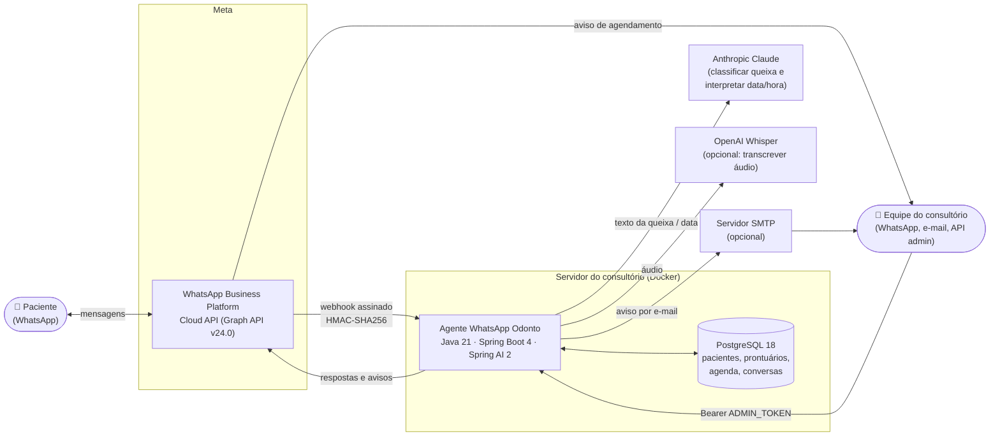
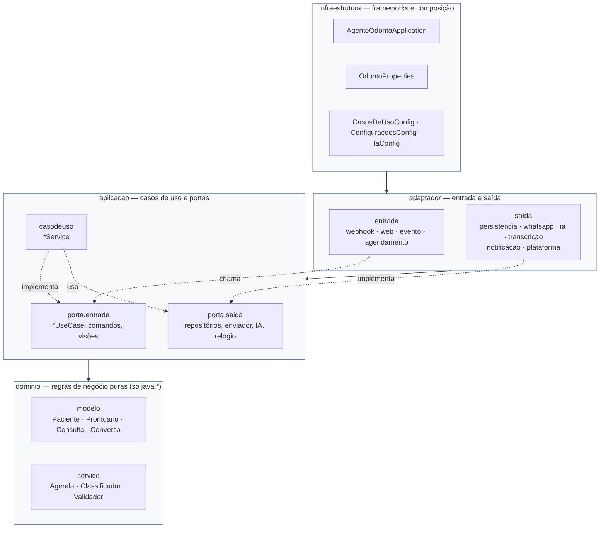
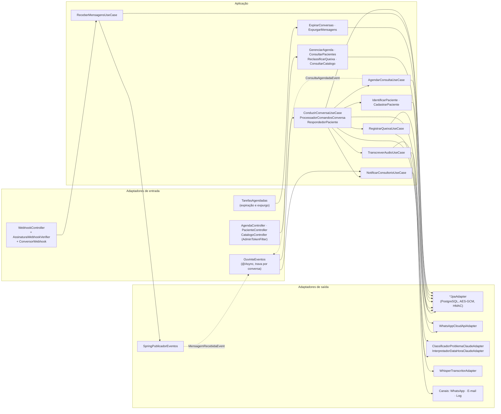
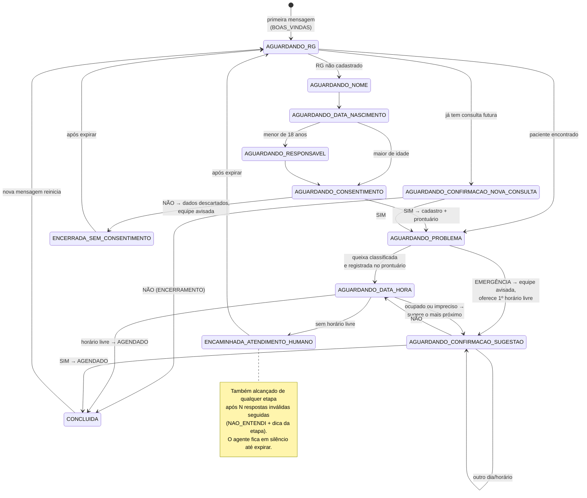
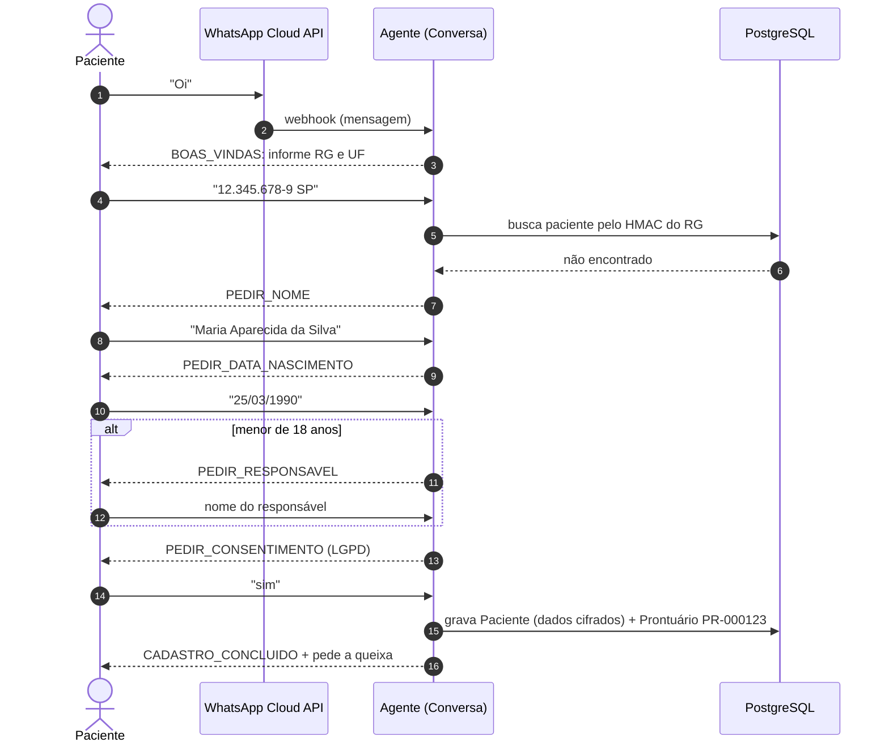
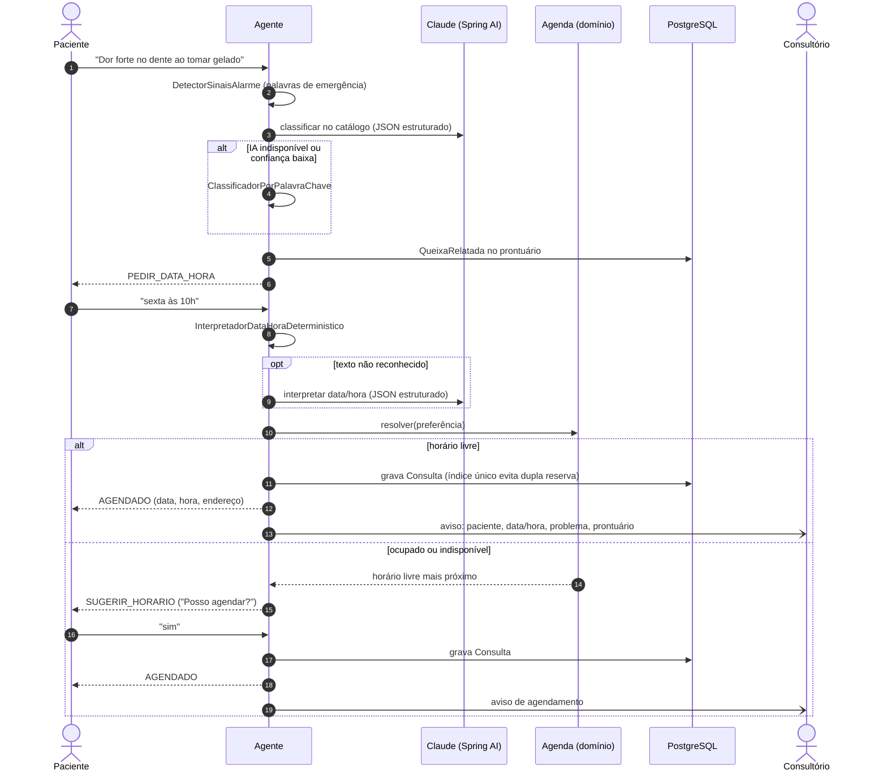
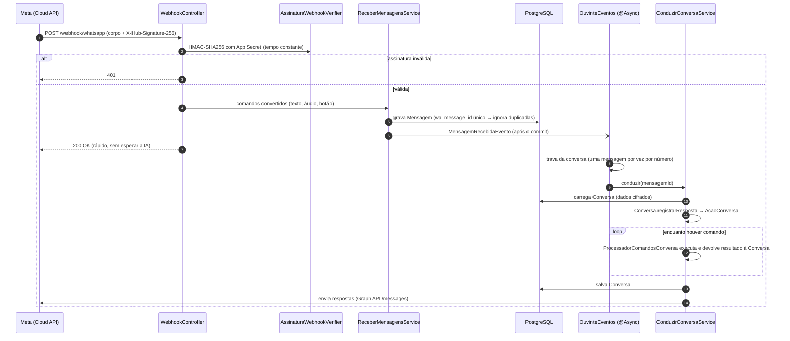
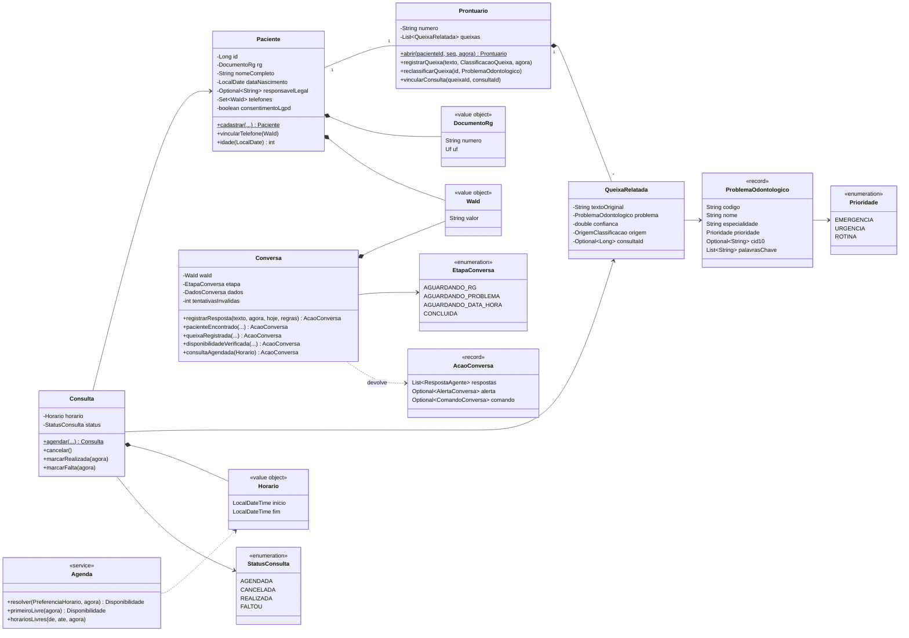
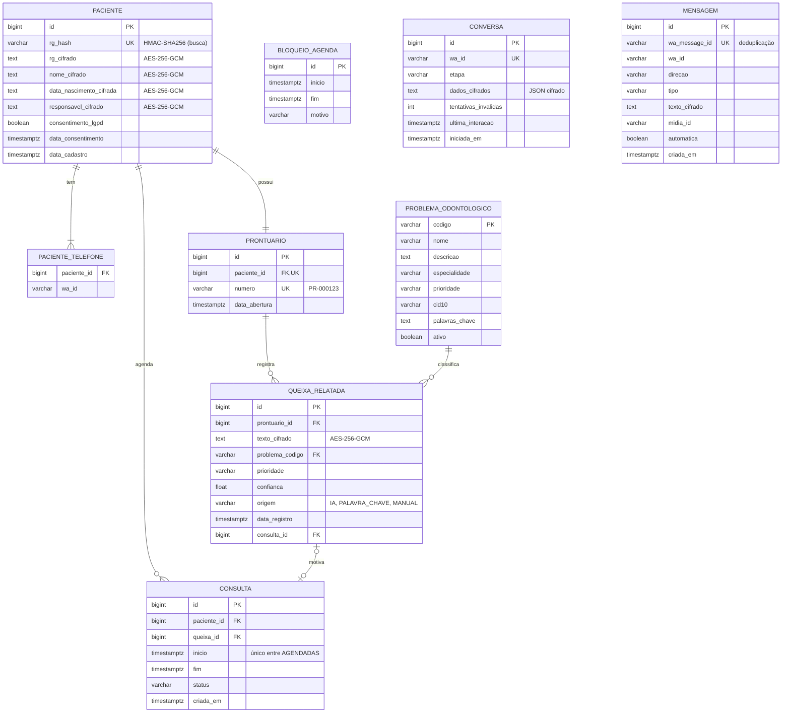
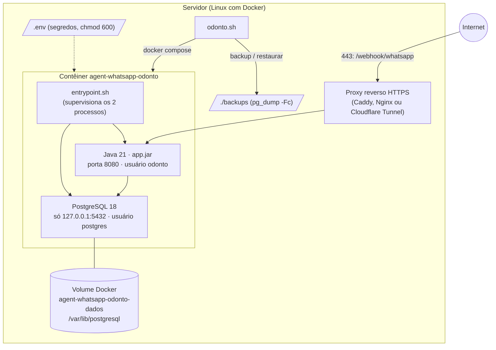

# Diagramas

Diagramas em [Mermaid](https://mermaid.js.org/), renderizados automaticamente pelo GitHub. As fontes ficam em [`fonte/`](fonte/) (arquivos `.mmd`) e podem ser exportadas para PNG/SVG com o [Mermaid CLI](https://github.com/mermaid-js/mermaid-cli):

```bash
npx -p @mermaid-js/mermaid-cli mmdc -i docs/diagramas/fonte/04-maquina-estados-conversa.mmd -o maquina-estados.svg
```

## Índice

1. [Contexto do sistema](#1-contexto-do-sistema)
2. [Camadas da Clean Architecture](#2-camadas-da-clean-architecture)
3. [Componentes, portas e adaptadores](#3-componentes-portas-e-adaptadores)
4. [Máquina de estados da conversa](#4-máquina-de-estados-da-conversa)
5. [Sequência: primeiro contato e cadastro](#5-sequência-primeiro-contato-e-cadastro)
6. [Sequência: queixa e agendamento](#6-sequência-queixa-e-agendamento)
7. [Sequência: webhook e processamento assíncrono](#7-sequência-webhook-e-processamento-assíncrono)
8. [Classes do domínio](#8-classes-do-domínio)
9. [Modelo de dados (PostgreSQL)](#9-modelo-de-dados-postgresql)
10. [Implantação](#10-implantação)

## 1. Contexto do sistema

Atores e sistemas externos: paciente, Meta (WhatsApp Cloud API), Claude, Whisper (opcional), SMTP (opcional) e a equipe do consultório.

Fonte: [`fonte/01-contexto.mmd`](fonte/01-contexto.mmd)



## 2. Camadas da Clean Architecture

Regra de dependência: infraestrutura → adaptador → aplicação → domínio. Verificada automaticamente pelo `ArquiteturaTest` (ArchUnit).

Fonte: [`fonte/02-camadas.mmd`](fonte/02-camadas.mmd)



## 3. Componentes, portas e adaptadores

Como os adaptadores de entrada chamam as portas de entrada (casos de uso) e como os adaptadores de saída implementam as portas de saída.

Fonte: [`fonte/03-componentes.mmd`](fonte/03-componentes.mmd)



## 4. Máquina de estados da conversa

Etapas fixas da `Conversa` (workflow agêntico previsível e auditável).

Fonte: [`fonte/04-maquina-estados-conversa.mmd`](fonte/04-maquina-estados-conversa.mmd)



## 5. Sequência: primeiro contato e cadastro

Identificação pelo RG + UF, cadastro, consentimento LGPD e abertura do prontuário.

Fonte: [`fonte/05-sequencia-primeiro-contato.mmd`](fonte/05-sequencia-primeiro-contato.mmd)



## 6. Sequência: queixa e agendamento

Classificação da queixa (IA com plano B por palavras-chave), interpretação de data/hora e sugestão do horário livre mais próximo.

Fonte: [`fonte/06-sequencia-queixa-agendamento.mmd`](fonte/06-sequencia-queixa-agendamento.mmd)



## 7. Sequência: webhook e processamento assíncrono

Assinatura, deduplicação, evento após o commit, processamento assíncrono com trava por conversa.

Fonte: [`fonte/07-sequencia-webhook.mmd`](fonte/07-sequencia-webhook.mmd)



## 8. Classes do domínio

Modelo rico: as regras ficam nos objetos (Paciente, Prontuario, Consulta, Conversa) e no serviço de domínio Agenda.

Fonte: [`fonte/08-classes-dominio.mmd`](fonte/08-classes-dominio.mmd)



## 9. Modelo de dados (PostgreSQL)

Tabelas criadas pelo Flyway (`V1__esquema_inicial.sql`). Colunas `*_cifrado` usam AES-256-GCM; `rg_hash` é HMAC-SHA256.

Fonte: [`fonte/09-modelo-dados.mmd`](fonte/09-modelo-dados.mmd)



## 10. Implantação

Um único contêiner com a aplicação e o PostgreSQL, volume persistente e proxy reverso HTTPS na frente.

Fonte: [`fonte/10-implantacao.mmd`](fonte/10-implantacao.mmd)


